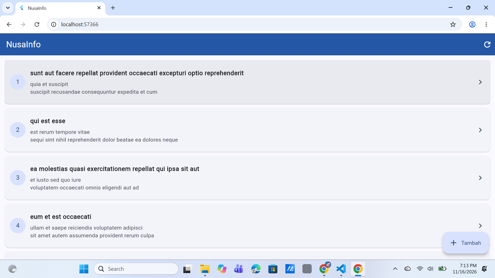
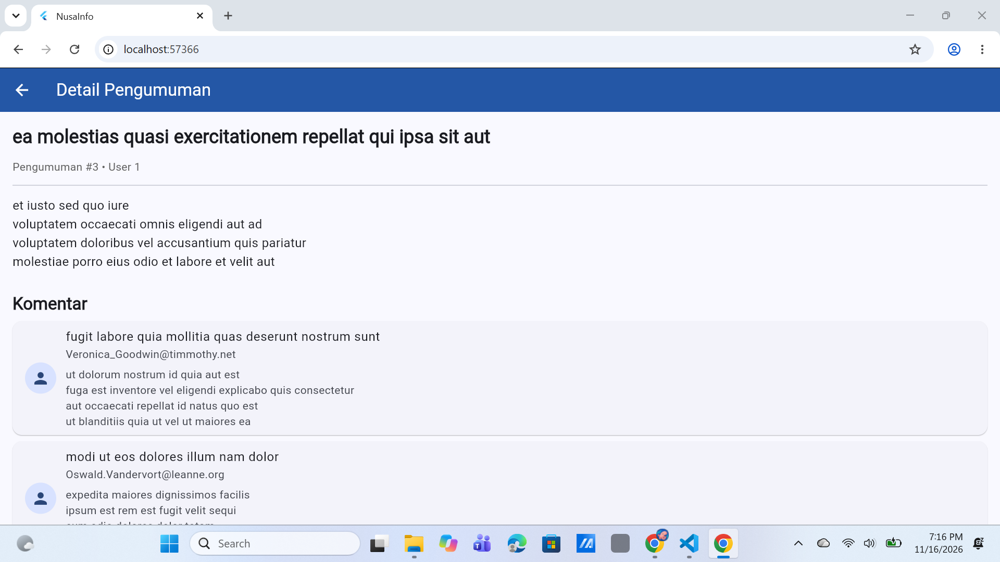
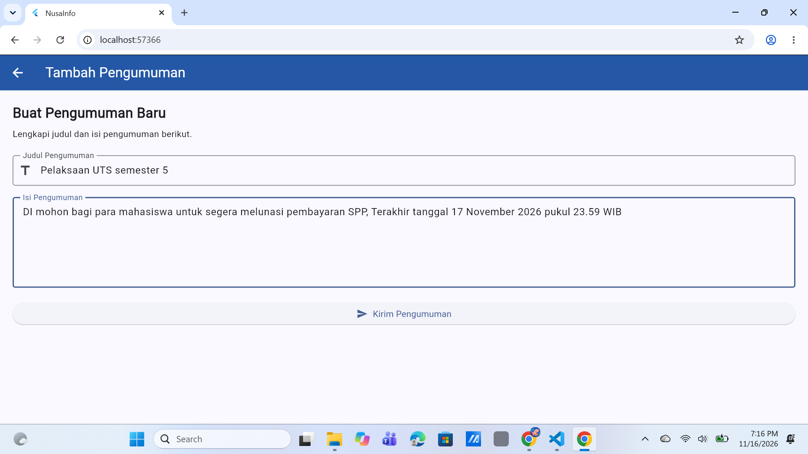
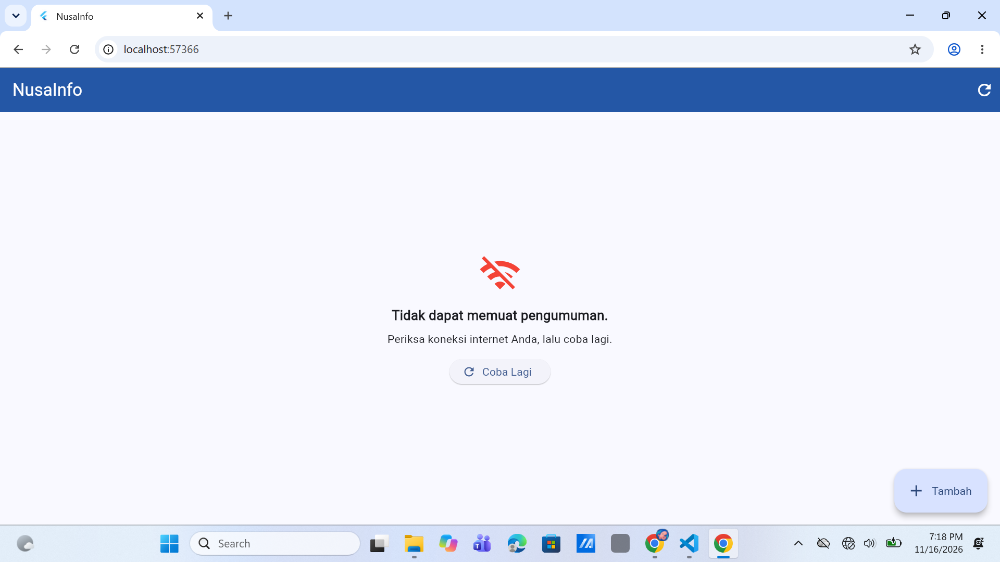
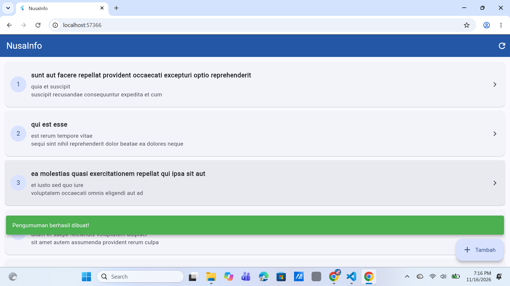
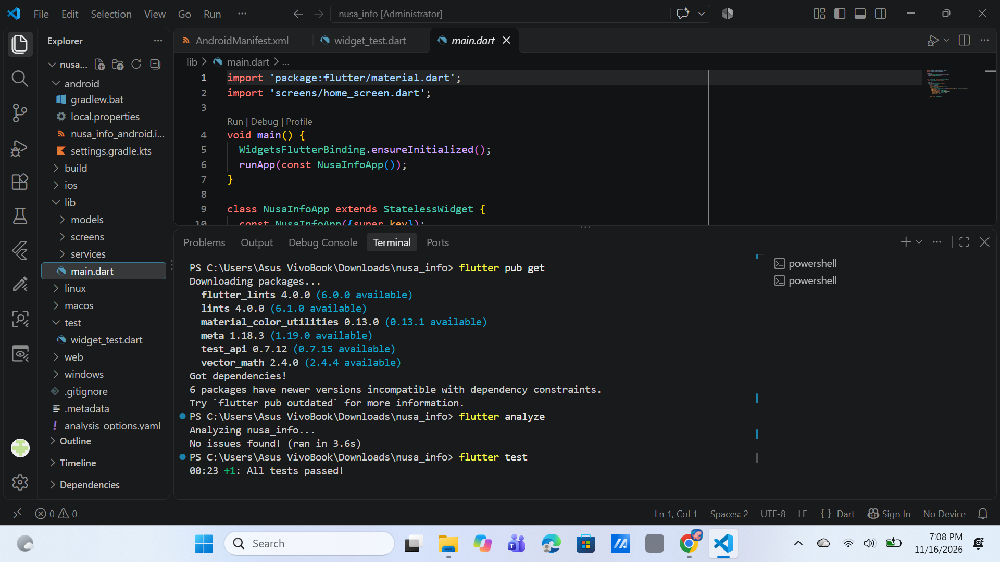

# NusaInfo

Aplikasi Flutter sederhana untuk menampilkan pengumuman dari JSONPlaceholder API.

## Fitur
- Daftar pengumuman dari `GET /posts`.
- Detail pengumuman dan komentar dari `GET /posts/{id}/comments`.
- Tambah pengumuman menggunakan `POST /posts`.
- Loading, pesan error, tombol Coba Lagi, pull-to-refresh, validasi form, dan SnackBar.

## Teknologi
- Flutter
- Dart
- package `http`
- API: https://jsonplaceholder.typicode.com

## Menjalankan aplikasi
1. Pastikan Flutter dan Android SDK sudah terpasang.
2. Jalankan `flutter pub get`.
3. Jalankan emulator atau hubungkan HP dengan USB debugging aktif.
4. Jalankan `flutter run`.

Jika membuat project dari awal, gunakan:
```bash
flutter create nusa_info
```
Lalu salin folder `lib/`, file `pubspec.yaml`, dan `README.md` dari paket ini ke folder project. Pilih Replace jika diminta.

## Pengujian
1. **Home:** pastikan daftar pengumuman tampil dari endpoint `/posts`.
2. **Detail:** ketuk salah satu pengumuman, pastikan isi dan komentar tampil.
3. **Tambah:** isi judul dan isi, lalu tekan Kirim Pengumuman. Home menampilkan SnackBar setelah halaman form ditutup.
4. **Validasi:** coba kirim form kosong untuk melihat pesan validasi.
5. **Internet mati:** matikan koneksi internet, buka ulang aplikasi atau tekan Coba Lagi. Home akan menampilkan pesan error dan tombol Coba Lagi.
6. **Refresh:** tarik daftar ke bawah untuk memuat ulang.

## Screenshot untuk pengumpulan
Simpan screenshot hasil pengujian ke folder `screenshots/`, lalu masukkan gambar ke bagian berikut. Screenshot perlu diambil dari emulator/HP setelah aplikasi benar-benar dijalankan.

### 1. Home Screen


### 2. Detail Screen


### 3. Add Post Screen


### 4. Pesan error saat internet mati


### 5. SnackBar setelah pengumuman berhasil dibuat


### 6. Flutter 


## Catatan API
JSONPlaceholder adalah layanan REST API palsu untuk latihan. Endpoint POST `/posts` mengembalikan respons simulasi (umumnya ID 101), tetapi data baru tidak disimpan permanen di server.

## Struktur folder
```text
lib/
├── models/
│   └── post.dart
├── services/
│   └── post_service.dart
├── screens/
│   ├── home_screen.dart
│   ├── detail_screen.dart
│   └── add_post_screen.dart
└── main.dart
```
